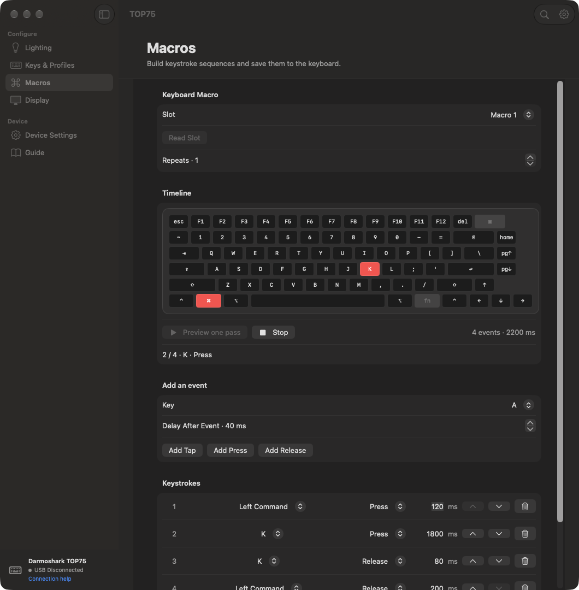
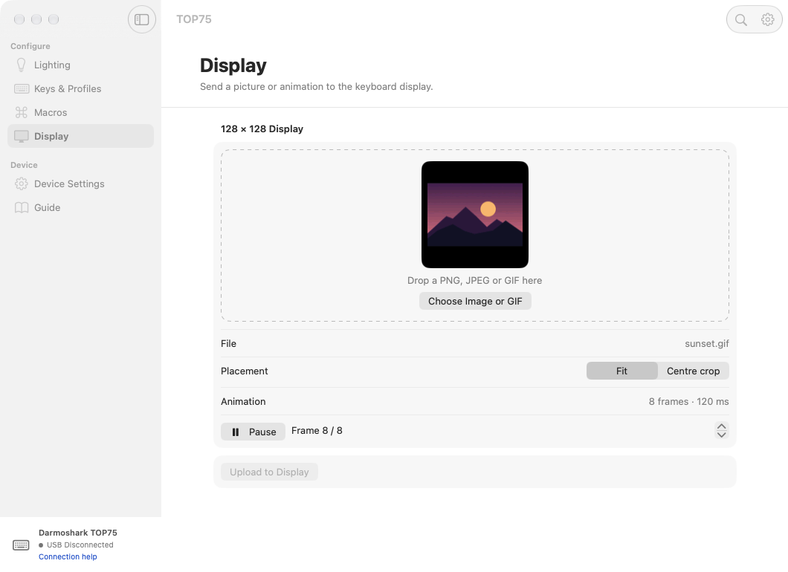

<div align="center">
  
  <h1>TOP75 for macOS</h1>
  <p>Set up your Darmoshark TOP75 from a native Mac app.</p>
  <a href="https://github.com/kreativecenter/top75-macos/releases"></a>
  <a href="#compatibility"></a>
  <a href="LICENSE"></a>
  <p><a href="https://github.com/kreativecenter/top75-macos/releases/latest/download/TOP75-macOS.dmg"><strong>Download DMG</strong></a> · <a href="#quick-start">Quick start</a> · <a href="#build-from-source">Build</a> · <a href="docs/README.tr.md">Türkçe</a></p>
</div>

## Quick start

1. Open [**TOP75-macOS.dmg**](https://github.com/kreativecenter/top75-macos/releases/latest/download/TOP75-macOS.dmg) and drag **TOP75.app** to **Applications**. A [ZIP download](https://github.com/kreativecenter/top75-macos/releases/latest/download/TOP75-macOS.zip) is also available.
2. Connect the keyboard with a **USB data cable**. Set its mode switch to **OFF** and check that the keyboard display shows **USB**.
3. Open TOP75. **USB Connected** appears in the sidebar. Read the current setting, make your changes, and click the matching **Apply** button.

**English and Türkçe** are available in **TOP75 → Settings** (⌘,). The app follows your Mac’s language by default and switches immediately when you choose a language. Press **⌘F** to search the guide and open the matching panel. Use **Connection Help** in the sidebar for USB setup.

### Connect over Bluetooth

Pair **TOP75 BT3.0** with your Mac and open TOP75. Click **Allow Bluetooth access** in the sidebar and enable TOP75 in **System Settings → Privacy & Security → Input Monitoring**. Reopen the app if macOS asks. Use Bluetooth for lighting, profiles, key assignments, macros, and device settings, including JSON backup and restore. Connect over USB to upload display artwork.

### Schedule lights off

In the **Schedule** sidebar panel, choose a daily start and end time, such as 23:00–08:00. TOP75 turns the keyboard lighting off and brings back the previous effect when the interval ends. Close the window to keep the app running, or enable **Start TOP75 at login** to start it automatically. **Skip this interval** brings the lighting back early. The keyboard needs an active USB or Bluetooth connection for TOP75 to apply the change.

## Screenshots

**Lighting**


**Keys & Profiles**


**Macro timeline and GIF preview**

<table>
  <tr>
    <td width="49%"></td>
    <td width="51%"></td>
  </tr>
</table>

## What you can configure

| Panel | Controls |
| --- | --- |
| **Lighting** | Preview RGB effects on the keyboard diagram, even without a USB connection. Adjust color, brightness, speed and direction before applying. Switch to Per-key Color to select and paint several keys together, review the draft and apply it in one action. Save up to five presets on the Mac. |
| **Schedule** | Choose when the keyboard lights turn off each day, skip the current interval, or start TOP75 automatically at login. |
| **Keys & Profiles** | See the current assignment as soon as you select a key or layer. Edit key, media and macro assignments, see modified keys on the layout and name the three onboard profiles on your Mac. |
| **Macros** | Edit, reorder and delete press and release events. Preview one pass on the keyboard diagram without sending keystrokes. |
| **Display** | Drop a PNG, JPEG or GIF and preview the 128 × 128 output with Fit or Centre Crop. Send stills to one of five slots or upload a GIF with up to 25 frames. Upload progress stays visible when switching panels. |
| **Device Settings** | Adjust debounce, automatic OS detection, and the Bluetooth and 2.4 GHz sleep timers. Export a JSON backup. Compare it with the keyboard and restore selected key assignments, colors and device settings. |

Configuration runs locally. The app reads back supported settings after writes and shows the result. Effects, per-key colors and key assignments support undo after a verified change. JSON restore requires the same firmware as the backup. Older JSON backups supply Fn assignments for the profile that was active when they were saved. Profile names are stored on the Mac. Macro contents and display artwork are outside the JSON format.

## Compatibility

- **Keyboard** — Darmoshark TOP75, USB device ID **957**. The app checks the keyboard’s reported ID before reading or writing settings.
- **Mac** — macOS **14 Sonoma** or later. The DMG and ZIP contain the same universal app for Apple Silicon and Intel. Hardware testing has used an Apple Silicon Mac.
- **Connection** — wired USB supports every panel. TOP75 BT3.0 supports all configuration panels except display uploads and requires Input Monitoring permission.
- **Release status** — check the release notes for signing and notarization status. Still-image upload, batch color writes and selective JSON restore were verified on a wired TOP75. On-device GIF playback still needs physical validation. Firmware flashing, live music or screen effects, and mouse-event macros remain open.

## Build from source

With Xcode and Swift 6 installed:

```sh
git clone https://github.com/kreativecenter/top75-macos.git
cd top75-macos
./scripts/build.sh
```

The build creates `dist/TOP75.app` and `dist/TOP75-macOS.zip`. It checks the signature, both languages, search, the keyboard diagram’s slot mapping, and the report and macro encoders, selective restore and the GIF rendering pipeline. Open `Package.swift` in Xcode or run `swift run TOP75` for development.

## Developer ID distribution

Build the app first. On a Mac with a **Developer ID Application** signing identity and a notarization profile saved in Keychain, run:

```sh
./scripts/notarize.sh "Developer ID Application: Your Name (TEAMID)" "top75-notary"
```

The script signs with the hardened runtime, waits for Apple's notarization decision, attaches the ticket to the app, and verifies Gatekeeper acceptance before packaging the distribution ZIP and its SHA-256 checksum. Configure the notarization profile locally with `xcrun notarytool store-credentials top75-notary`. To create a drag-to-install disk image from the notarized app, run `./scripts/dmg.sh /path/to/TOP75.app`. See [Apple's notarization guide](https://developer.apple.com/documentation/security/notarizing-macos-software-before-distribution).

## Contribute

[Open an issue](https://github.com/kreativecenter/top75-macos/issues/new) with the app version, macOS version, connection type and steps to reproduce. Read the [protocol and hardware notes](docs/protocol.md) before changing device commands. UI translations are in `Sources/TOP75/Resources`.

The app is maintained by [Bedirhan Samsa](https://github.com/BEDIRHANSAMSA) under the [MIT license](LICENSE). Darmoshark and TOP75 identify the compatible hardware. This community project has no vendor affiliation.

The [sharkfin protocol documentation](https://github.com/dniminenn/sharkfin/blob/master/docs/PROTOCOL.md) was used to cross-check the USB report format.
