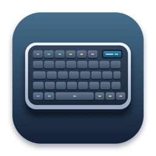
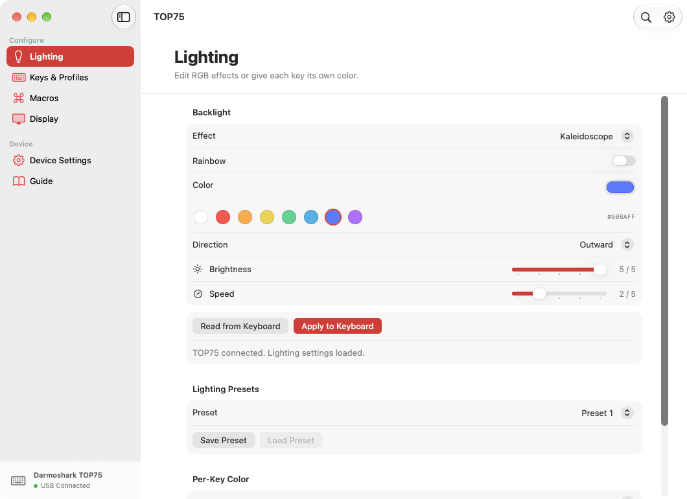
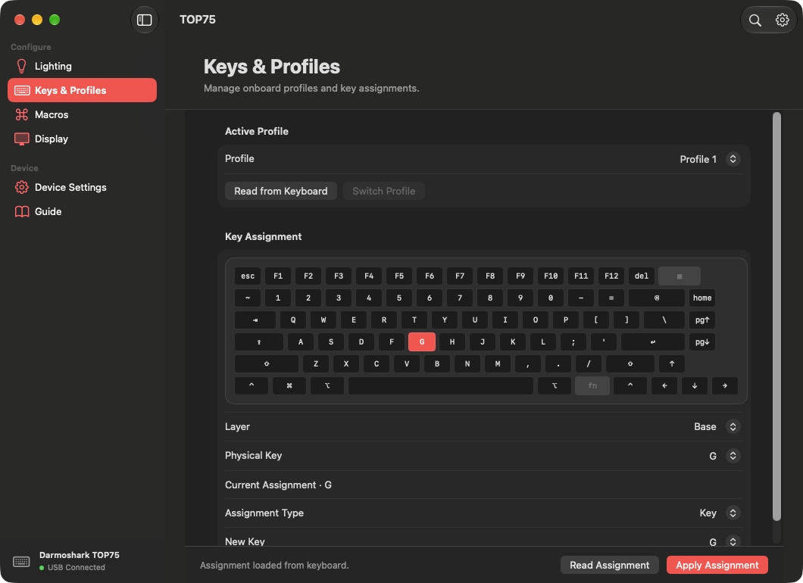

<div align="center">
  
  <h1>TOP75 for macOS</h1>
  <p>Set up your Darmoshark TOP75 from a native Mac app.</p>
  <a href="https://github.com/kreativecenter/top75-macos/releases"></a>
  <a href="#compatibility"></a>
  <a href="LICENSE"></a>
  <p><a href="https://github.com/kreativecenter/top75-macos/releases/latest/download/TOP75-macOS.dmg"><strong>Download DMG</strong></a> · <a href="#quick-start">Quick start</a> · <a href="#build-from-source">Build</a> · <a href="docs/README.tr.md">Türkçe</a></p>
</div>

## Quick start

1. Open [**TOP75-macOS.dmg**](https://github.com/kreativecenter/top75-macos/releases/latest/download/TOP75-macOS.dmg) and drag **TOP75.app** to **Applications**. A [ZIP download](https://github.com/kreativecenter/top75-macos/releases/latest/download/TOP75-macOS.zip) is also available.
2. Connect the keyboard with a **USB data cable**. Set its mode switch to **OFF** and check that the keyboard display shows **USB**.
3. Open TOP75. **USB Connected** appears in the sidebar. Read the current setting, make your changes, and click the matching **Apply** button.

**English and Türkçe** are available in **TOP75 → Settings** (⌘,). The app follows your Mac’s language by default and switches immediately when you choose a language. Press **⌘F** to search the built-in guide.

## Screenshots

**Lighting**



**Keys & Profiles**



## What you can configure

| Panel | Controls |
| --- | --- |
| **Lighting** | Global RGB and rainbow effects, brightness, speed and direction. Pick a key on the layout to set its color. Save up to five presets on the Mac. |
| **Keys & Profiles** | Select a physical key on the layout, then edit its base or Fn assignment. Assign a key, media command or onboard macro. Switch between three profiles. |
| **Macros** | Edit keyboard strokes, delays and repeat counts in onboard macro slots. |
| **Display** | Preview artwork, then send a PNG or JPEG to one of five still-image slots. GIF upload is available for animations of up to 25 frames. |
| **Device Settings** | Adjust debounce, automatic OS detection, and the Bluetooth and 2.4 GHz sleep timers. Export keymaps, lighting and device settings to JSON. |

Configuration runs locally over USB. The app reads back supported settings after writes and shows the result.

## Compatibility

- **Keyboard** — Darmoshark TOP75, USB device ID **957**. The app checks the keyboard’s reported ID before reading or writing settings.
- **Mac** — macOS **14 Sonoma** or later. The DMG and ZIP contain the same universal app for Apple Silicon and Intel. Hardware testing has used an Apple Silicon Mac.
- **Connection** — use wired USB for configuration. Bluetooth and 2.4 GHz configuration are outside the current release.
- **Release status** — check the release notes for signing and notarization status. Still-image transfer has been exercised on a TOP75. GIF playback needs further hardware verification. The app can export a settings snapshot. Restoring it, firmware flashing, live music or screen effects, and mouse-event macros remain open.

## Build from source

With Xcode and Swift 6 installed:

```sh
git clone https://github.com/kreativecenter/top75-macos.git
cd top75-macos
./scripts/build.sh
```

The build creates `dist/TOP75.app` and `dist/TOP75-macOS.zip`. It checks the signature, both languages, search, the keyboard diagram’s slot mapping, and the report, macro and image encoders. Open `Package.swift` in Xcode or run `swift run TOP75` for development.

## Developer ID distribution

Build the app first. On a Mac with a **Developer ID Application** signing identity and a notarization profile saved in Keychain, run:

```sh
./scripts/notarize.sh "Developer ID Application: Your Name (TEAMID)" "top75-notary"
```

The script signs with the hardened runtime, waits for Apple's notarization decision, attaches the ticket to the app, and verifies Gatekeeper acceptance before packaging the distribution ZIP and its SHA-256 checksum. Configure the notarization profile locally with `xcrun notarytool store-credentials top75-notary`. To create a drag-to-install disk image from the notarized app, run `./scripts/dmg.sh /path/to/TOP75.app`. See [Apple's notarization guide](https://developer.apple.com/documentation/security/notarizing-macos-software-before-distribution).

## Contribute

[Open an issue](https://github.com/kreativecenter/top75-macos/issues/new) with the app version, macOS version, connection type and steps to reproduce. Read the [protocol and hardware notes](docs/protocol.md) before changing device commands. UI translations are in `Sources/TOP75/Resources`.

The app is maintained by [Bedirhan Samsa](https://github.com/BEDIRHANSAMSA) under the [MIT license](LICENSE). Darmoshark and TOP75 identify the compatible hardware. This community project has no vendor affiliation.

The [sharkfin protocol documentation](https://github.com/dniminenn/sharkfin/blob/master/docs/PROTOCOL.md) was used to cross-check the USB report format.
