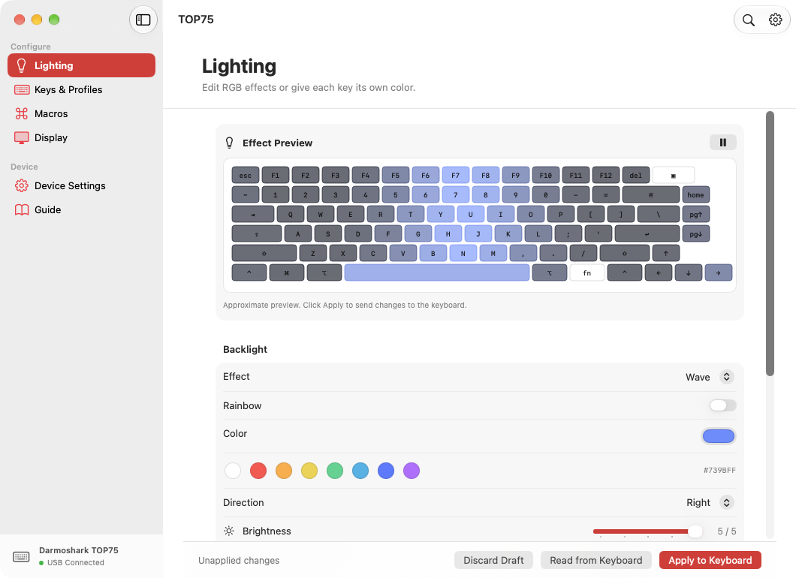
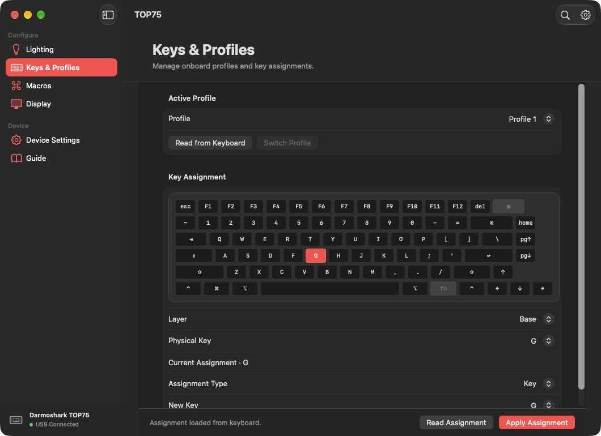
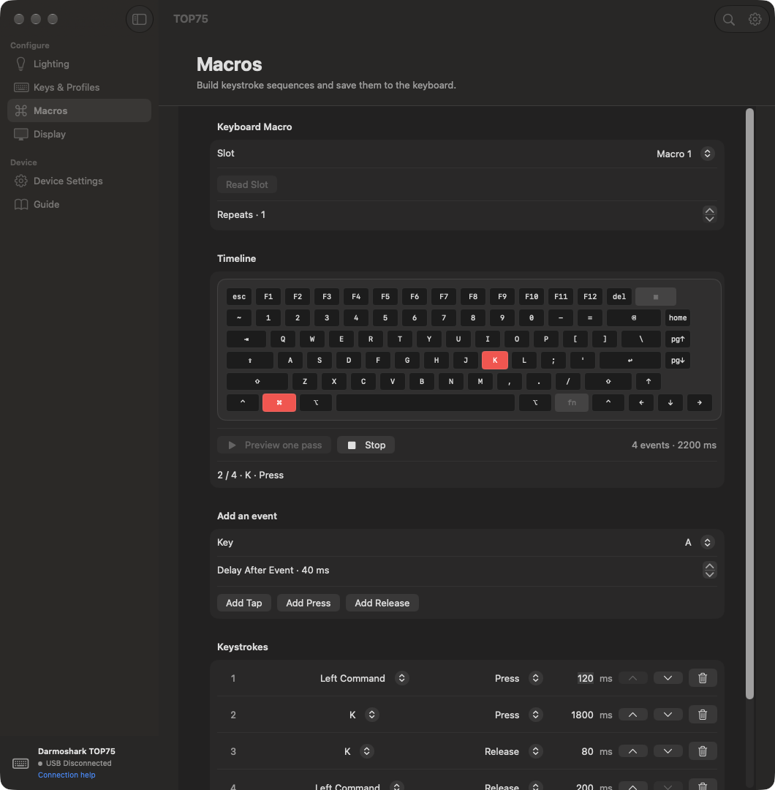
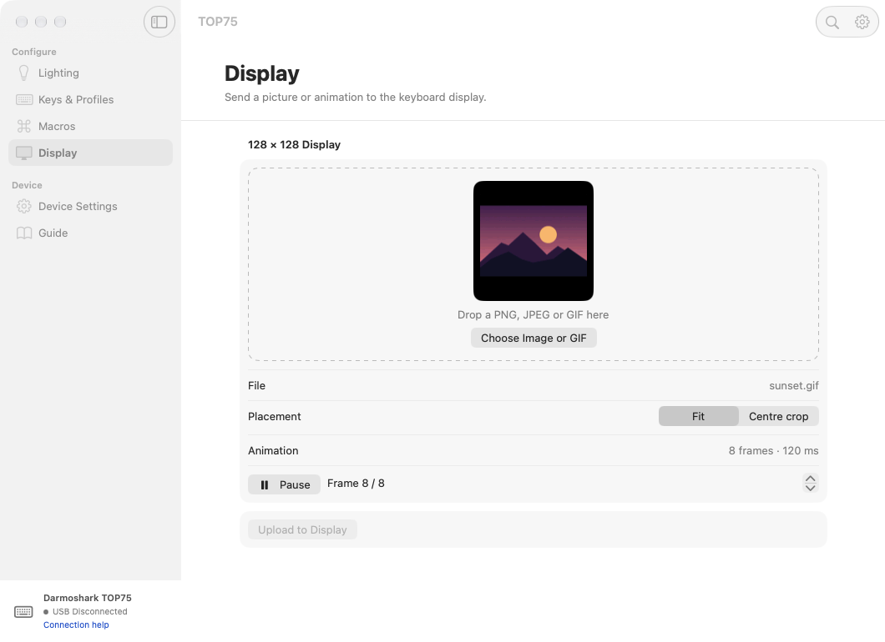

# Darmoshark TOP75 macOS uygulaması

Darmoshark TOP75 için ücretsiz ve açık kaynak Mac uygulaması. RGB rengini değiştir, tuşları yeniden ata, makro düzenle, ışığın kapanacağı saatleri seç ve klavye ekranına görsel yükle. Apple Silicon ve Intel Mac’lerde macOS 14 ve üzerini destekler.

**[DMG indir](https://github.com/kreativecenter/top75-macos/releases/latest/download/TOP75-macOS.dmg) · [İngilizce README](../README.md) · [Protokol notları](protocol.md)**

## Başlangıç

1. [**TOP75-macOS.dmg**](https://github.com/kreativecenter/top75-macos/releases/latest/download/TOP75-macOS.dmg) dosyasını aç ve **TOP75.app**’i **Uygulamalar** klasörüne sürükle. [ZIP paketi](https://github.com/kreativecenter/top75-macos/releases/latest/download/TOP75-macOS.zip) de mevcut.
2. TOP75’i veri taşıyan bir USB kablosuyla bağla. Mod anahtarını **OFF** konumuna getir ve klavye ekranında **USB** yazdığını kontrol et.
3. Kenar çubuğunda **USB bağlı** göründüğünde bir panel aç. Mevcut ayarı oku, değiştir ve klavyeye uygula.

**TOP75 → Ayarlar** (⌘,) menüsünden İngilizce, Türkçe veya sistem dilini seçebilirsin. **⌘F** ile kılavuzda ara ve ilgili paneli aç. USB kurulum adımları için kenar çubuğundaki **Bağlantı yardımı** düğmesini kullan.

### Bluetooth ile bağlan

Mac’te **TOP75 BT5.0** veya **TOP75 BT3.0** ile eşleş ve TOP75’i aç. Kenar çubuğunda **Bluetooth erişimine izin ver** düğmesine bas. **Sistem Ayarları → Gizlilik ve Güvenlik → Giriş İzleme** bölümünde TOP75’i etkinleştir. macOS isterse uygulamayı yeniden aç. Aydınlatma, profiller, tuş atamaları, makrolar ve JSON yedekleme dahil cihaz ayarları Bluetooth üzerinden çalışır. Ekrana görsel yüklemek için USB ile bağlan.

### Tuşları test et, makro kaydet ve ön ayar paylaş

- **Tuş testi** ekranında klavyenin gönderdiği tuş kodlarını, çoklu basışları ve medya olaylarını gör. **Bağlantı tanısı** ayar bağlantısını, firmware yanıtını ve pil kaynağını gösterir. Tanıyı destek için kopyalayabilirsin.
- Araç çubuğundan veya **⇧⌘K** ile **Tuş haritası** penceresini aç. Etkin profilin Temel ve Fn atamalarını görüntüle, pencereyi üstte tut veya iki katmanı PDF olarak kaydet.
- **Makrolar** bölümünde hedef yuvayı oku ve **Makro kaydet**’i aç. Tuşlara basarak zaman çizelgesini oluştur ve önizledikten sonra klavyeye yaz.
- **Cihaz ayarları → Paylaşılabilir ön ayarlar** bölümünden RGB, seçili tuş atamaları veya tek makroyu ayrı dosyaya kaydet. İçe aktarırken değişiklikleri gözden geçir. Tuş atamaları etkin profile uygulanır ve firmware sürümü eşleşmelidir.
- **Ekran → Ekran şablonları** bölümünde isim, monogram veya piksel çizimi oluştur. 128 × 128 sonucu önizle ve USB ile klavye ekranına yükle.
- macOS **Kestirmeler** uygulamasında **TOP75 Aydınlatmasını Ayarla** ve **TOP75 Profilini Seç** eylemlerini kullan.

### Klavyede Codex ve Claude limitlerini göster

**Ekran → Codex ve Claude limitleri** bölümünde yenile. Kart, 5 saatlik ve 7 günlük limit yüzdelerini gösterir. Önizlemenin üstünden **Kullanılan** veya **Kalan** seç. Codex için ChatGPT hesabına giriş yapılmış yerel Codex CLI kullanılır. **Claude Code’u bağla** düğmesini bir kez kullan, Claude Code’da yeni bir yanıt al ve limitleri yenile. Bağlantıyı kaldırınca önceki status line komutu geri yüklenir.

Beş görsel yuvasından birini seçip USB üzerinden aktar. Otomatik mod 15 dakikada bir kontrol eder ve ekrandaki yüzdeler değiştiğinde kartı gönderir. Menü çubuğu simgesi açıkken pencereyi kapatmak, **⌘Q** veya Dock’tan **Çık** TOP75’i arka planda bırakır. Uygulamayı kapatmak için menü çubuğundaki **TOP75’ten çık** komutunu seç. Klavye güncellemeler arasında son yüklenen görseli tutar.

### Işık kapatma aralığı

Kenar çubuğundaki **Zamanlama** panelinde günlük başlangıç ve bitiş saatlerini seç. Örneğin 23.00–08.00 arasında klavyenin ışığı kapanır ve 08.00’de önceki efekt geri gelir. Pencere kapalıyken uygulama çalışmaya devam eder. İstersen **Oturum açınca TOP75’i başlat** seçeneğini aç. Işığı erkenden geri getirmek için **Bu aralığı atla** düğmesini kullan. Uygulamanın değişikliği yapabilmesi için klavyenin USB veya Bluetooth ile bağlı olması gerekir.

### Klavyenin pil seviyesine bak

Kenar çubuğu **TOP75 BT5.0** ve **2,4 GHz USB alıcısı** bağlantılarında pil yüzdesini gösterir. BT5.0’da uygulama, macOS’un tuttuğu değeri yaklaşık 30 saniyede bir okur. **Cihaz ayarları → Pil ve şarj** bölümünden **Düşük pil bildirimi**ni aç ve macOS bildirim iznini ver. TOP75 çalışırken pil %20 veya altındaysa uyarı alırsın. Şarj animasyonu klavyenin ekranında görünür. Klavye ayarları USB, Bluetooth ve 2,4 GHz alıcı üzerinden değiştirilebilir.

## Sık sorulan sorular

### TOP75’in RGB ışığını Mac’te Bluetooth üzerinden değiştirebilir miyim?

Evet. **TOP75 BT5.0** veya **TOP75 BT3.0** ile eşleş, **Giriş İzleme** iznini ver ve **Aydınlatma** panelini aç. Efektleri ve tuş renklerini buradan uygulayabilirsin. [Bluetooth kurulum adımları](#bluetooth-ile-bağlan)

### Klavye Bluetooth ile bağlıyken uygulama neden “USB bağlantısı yok” diyor?

**TOP75 → TOP75 Hakkında** menüsünden sürüme bak. Bluetooth aydınlatması **0.7.0** ile, profil, tuş ataması ve makro gibi diğer Bluetooth özellikleri **0.8.0** ile eklendi. Dock eski bir kopyayı açarsa **Finder → Uygulamalar → TOP75** üzerinden aç. [En yeni Mac sürümünü indir](https://github.com/kreativecenter/top75-macos/releases/latest)

## Mac’te hızlı kontroller ve otomasyonlar

- **Menü çubuğu.** Bağlantıyı, pili ve etkin profili gör. Profili değiştir, ışığı açıp kapat veya o anki zamanlama aralığını atla.
- **Pil tasarrufu.** Cihaz ayarlarında pil eşiğini ve ışığı kısma veya kapatma seçeneğini belirle. Pil seçilen eşiğin 5 puan üzerine çıkınca önceki aydınlatma geri gelir. Işık kapatma zamanlaması önceliklidir. Elle değişiklik yaparsan pil toparlanana kadar tasarruf bekler.
- **Uygulamaya göre profil.** Cihaz ayarlarından uygulama ekle ve profil seç. Kuralsız uygulamalar için varsayılan profili belirle. Elle profil seçimi, ön plandaki uygulama değişene kadar geçerlidir.
- **Makro yedeği.** Yeni JSON yedeği 50 makro yuvasını içerir. Geri yükleme önizlemesinden istediğin yuvaları seçebilirsin. Eski JSON dosyaları açılabilir.

Tam yedek 50 yuvayı okur. 2,4 GHz bağlantısı dışa aktarım sırasında kesilirse yedeği USB kablosuyla al.

## Ekran görüntüleri

**Aydınlatma**

**Tuşlar ve profiller**

**Makro zaman çizelgesi ve GIF önizlemesi**

<table>
  <tr>
    <td width="49%"></td>
    <td width="51%"></td>
  </tr>
</table>

## Paneller

| Panel | İşlev |
| --- | --- |
| **Aydınlatma** | Canlı efekt önizlemesi, beş yerel ön ayar ve ayrı bir tuş rengi düzenleyicisi. Birden fazla tuşu seçip birlikte boya ve tek işlemde uygula. |
| **Zamanlama** | Işığın kapanacağı saatleri seç, etkin aralığı atla veya TOP75’i oturum açılışında başlat. |
| **Tuşlar ve profiller** | Seçilen tuşun mevcut ataması otomatik okunur. Temel ve Fn katmanını düzenle, değişen tuşları çizimde gör ve üç cihaz profiline bu Mac’te ad ver. |
| **Makrolar** | Basma ve bırakma olaylarını düzenle, sırala ve sil. Makroyu klavye çiziminde bir tur oynat ve basılı tuşları gör. |
| **Ekran** | PNG, JPEG veya GIF sürükleyip bırak. 128 × 128 önizlemede oynat, sığdır veya ortadan kırp. Aktarım ilerlemesi panel değiştirince de görünür. |
| **Cihaz ayarları** | Tuş tepkisini, otomatik işletim sistemi algılamayı ve kablosuz uyku sürelerini yönet. JSON kaydını klavyeyle karşılaştır ve istediğin farkları geri yükle. |

Apple Silicon ve Intel için derlenen uygulama macOS 14 ve üstünü hedefler. DMG ve ZIP, aynı imzalı ve Apple noter onaylı uygulamayı içerir. Uygulama TOP75 kimliği **957** olan modeli doğrular. Sabit görsel yükleme, toplu tuş rengi yazma ve seçmeli JSON geri yükleme fiziksel klavyede doğrulandı. GIF oynatma için fiziksel doğrulama bekleniyor. Geri yükleme için yedek ile klavyenin firmware sürümü eşleşmeli. Eski yedeklerde Fn atamaları, kaydın alındığı etkin profil için kullanılabilir. JSON kaydı ekran görsellerini kapsamaz. Firmware güncelleme, müzik ve ekran eşleme ile fare olaylı makrolar henüz yok.

Xcode ve Swift 6 ile depoda `./scripts/build.sh` çalıştırarak dağıtım paketini oluşturabilirsin. Kaynak kodu [MIT lisansı](../LICENSE) ile yayımlanır.

Geliştirici Bedirhan Samsa. [GitHub](https://github.com/BEDIRHANSAMSA) · [X’te @bedirhansamsa](https://x.com/bedirhansamsa)
