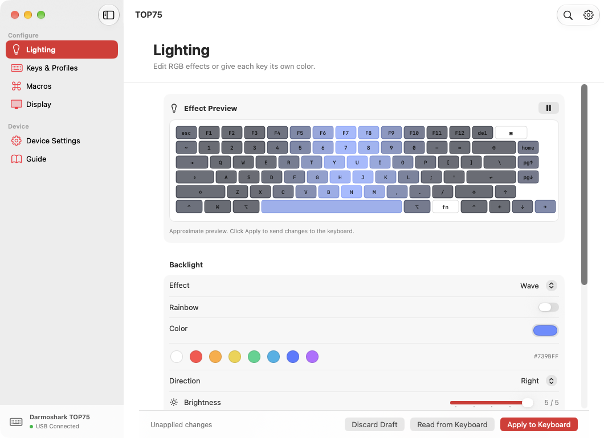
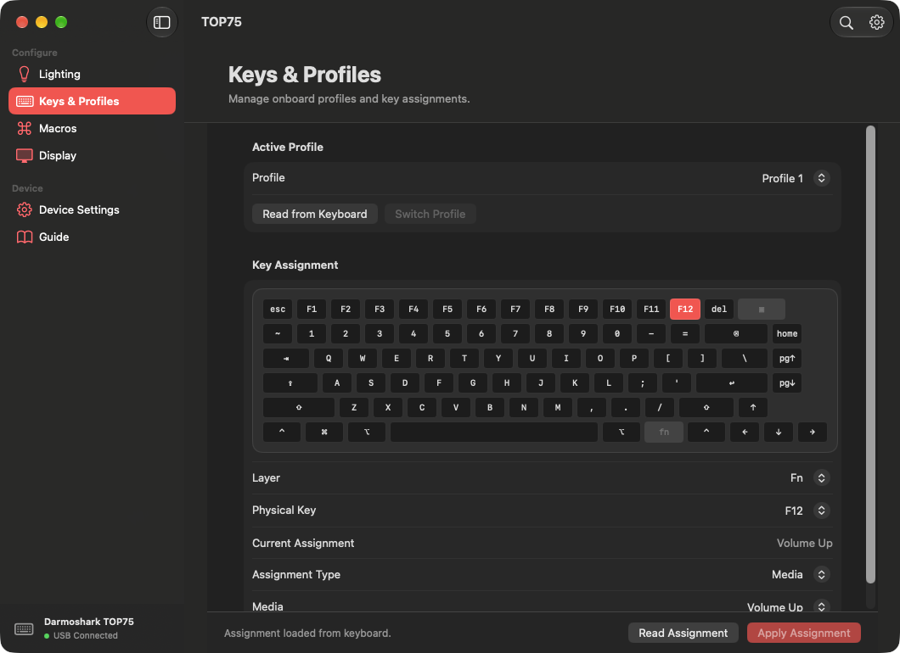

# macOS için TOP75

Darmoshark TOP75’i doğrudan USB üzerinden yapılandıran açık kaynak macOS uygulaması.

**[DMG indir](https://github.com/kreativecenter/top75-macos/releases/latest/download/TOP75-macOS.dmg) · [İngilizce README](../README.md) · [Protokol notları](protocol.md)**

## Başlangıç

1. [**TOP75-macOS.dmg**](https://github.com/kreativecenter/top75-macos/releases/latest/download/TOP75-macOS.dmg) dosyasını aç ve **TOP75.app**’i **Uygulamalar** klasörüne sürükle. [ZIP paketi](https://github.com/kreativecenter/top75-macos/releases/latest/download/TOP75-macOS.zip) de mevcut.
2. TOP75’i veri taşıyan bir USB kablosuyla bağla. Mod anahtarını **OFF** konumuna getir ve klavye ekranında **USB** yazdığını kontrol et.
3. Kenar çubuğunda **USB bağlı** göründüğünde bir panel aç. Mevcut ayarı oku, değiştir ve klavyeye uygula.

**TOP75 → Ayarlar** (⌘,) menüsünden İngilizce, Türkçe veya sistem dilini seçebilirsin. **⌘F** ile kılavuzda ara.

## Ekran görüntüleri

**Aydınlatma**

**Tuşlar ve profiller**

## Paneller

| Panel | İşlev |
| --- | --- |
| **Aydınlatma** | Canlı efekt önizlemesi, renk, yön, parlaklık ve hız. Tuş başına RGB ve beş yerel ön ayar. |
| **Tuşlar ve profiller** | Klavye çiziminden tuş seç, temel veya Fn katmanına tuş, multimedya işlevi veya makro ata. Üç cihaz profili arasında geçiş yap. |
| **Makrolar** | Tuş olayları, bekleme süreleri ve tekrar sayısını düzenle. |
| **Ekran** | PNG ve JPEG için önizleme ve beş sabit görsel yuvası. En fazla 25 kareli GIF aktarımı. |
| **Cihaz ayarları** | Tuş tepki süresi, otomatik işletim sistemi algılama, kablosuz uyku süreleri ve JSON ayar kaydı. |

Apple Silicon ve Intel için derlenen uygulama macOS 14 ve üstünü hedefler. DMG ve ZIP, aynı imzalı ve Apple noter onaylı uygulamayı içerir. Cihaz ayarları USB üzerinden yazılır ve uygulama TOP75 kimliği **957** olan modeli doğrular. Sabit görselin fiziksel klavyede görüntülendiği doğrulandı. GIF oynatma ayrıca test edilmelidir. JSON geri yükleme, kablosuz yapılandırma, firmware güncelleme, müzik ve ekran eşleme ile fare olaylı makrolar henüz yok.

Xcode ve Swift 6 ile depoda `./scripts/build.sh` çalıştırarak dağıtım paketini oluşturabilirsin. Kaynak kodu [MIT lisansı](../LICENSE) ile yayımlanır.
